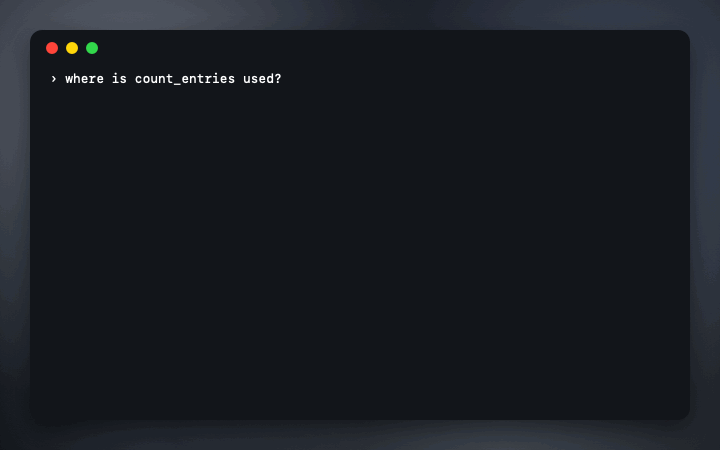

<p align="center">
  
</p>

<h1 align="center">symbolhop</h1>

<p align="center">
  <b>Go-to-definition and find-references for coding agents.</b><br>
  An MCP server and CLI that gives Codex, Claude Code, Gemini CLI and other terminal agents exact answers from the language servers you already have, instead of grepping. No dependencies, read-only, no network.
</p>

<p align="center">
  <a href="#set-it-up"><b>Set it up</b></a>
  &nbsp;·&nbsp;
  <a href="https://stanczykwyatt.github.io/symbolhop/">Website</a>
  &nbsp;·&nbsp;
  <a href="bench/RESULTS.md">Measurements</a>
  &nbsp;·&nbsp;
  <a href="https://github.com/users/stanczykwyatt/projects/1">Roadmap</a>
</p>

<p align="center">
  <a href="https://github.com/stanczykwyatt/symbolhop/actions/workflows/ci.yml"></a>
  <a href="https://github.com/stanczykwyatt/symbolhop/releases/latest"></a>
  
  
  <a href="LICENSE"></a>
</p>

<p align="center">
  
</p>

---

Ask a terminal agent where a function is used, and it greps. It gets back every comment, log message, string and similarly named symbol along with the real uses, reads them all, and sometimes still guesses wrong. Editors stopped doing that decades ago: they ask a language server.

symbolhop lets the agent ask too. It starts the language server for the file's language (clangd, typescript-language-server, pyright, gopls, rust-analyzer and others), and answers five questions exactly, in one short line per result.

**Measured** on a made-up C project ([rerun it yourself](bench/measure.mjs)): finding the uses of `count_entries` returned **10 exact lines** from `lsp_references`, against **59 to 77 lines from grep**, 49 to 67 of which weren't uses. That's about **9 to 11 times fewer tokens**, the best of three questions measured; the other two came out about 4 times and 2 to 3 times fewer. For a struct field named like local variables, grep returned 148 to 201 lines, 75 to 128 of them wrong; `lsp_references` returned the 73 real ones and missed none. The true uses were listed independently while the project was generated. Real projects will vary; the [full table](bench/RESULTS.md) says how it was measured.

If it saves your agent some guessing, [starring the repo](https://github.com/stanczykwyatt/symbolhop/stargazers) helps other people find it.

## The tools

| Tool | What the agent gets |
|---|---|
| `lsp_definition` | Where a symbol is defined: `src/config.h:11:5  int parse_config(const char *text, struct settings *out);` |
| `lsp_references` | Every use of it across the project, one line each, without comments, strings or other symbols with the same name |
| `lsp_hover` | Its type, signature and documentation |
| `lsp_diagnostics` | The errors and warnings in a file as it is on disk now, right after the agent edits it |
| `lsp_symbols` | A file's outline: classes, functions and fields, with line numbers |

The agent names the symbol instead of counting columns: `{"file": "src/main.c", "line": 14, "symbol": "parse_config"}`.

## Set it up

You need Node 20 or later, and a language server for your project's language on your PATH. `npx github:stanczykwyatt/symbolhop doctor` shows which it finds.

| Language | Server |
|---|---|
| C, C++, Objective-C | `clangd` (comes with Xcode's tools on a Mac, `apt install clangd` on Linux) |
| TypeScript, JavaScript | `npm install -g typescript-language-server typescript` |
| Python | `npm install -g pyright` |
| Go | `go install golang.org/x/tools/gopls@latest` |
| Rust | `rustup component add rust-analyzer` |
| Swift | `sourcekit-lsp` (comes with Swift) |
| Java, Ruby, Lua, Zig | `jdtls`, `ruby-lsp`, `lua-language-server`, `zls` |

Then add it to your agent. It runs in the folder the agent starts it in; add `--root /path/to/project` to pin one. `npx` fetches it from GitHub the first time, which can take a few seconds; if your agent gives up on slow servers, `npm install -g github:stanczykwyatt/symbolhop#v0.1.0` once and use `symbolhop serve` as the command.

By default it uses servers for C-family, TypeScript, Python, Go, Rust, Swift and Lua. Java, Ruby and Zig servers run the project's build files as soon as they start, so they're only used when you list them: `serve --languages c,typescript,java`. On Windows, servers installed with npm (typescript-language-server, pyright) don't start yet, because Node won't start `.cmd` files without a shell; clangd, gopls and rust-analyzer do.

**Codex** (`~/.codex/config.toml`):

```toml
[mcp_servers.symbolhop]
command = "npx"
args = ["-y", "github:stanczykwyatt/symbolhop#v0.1.0", "serve"]
```

**Claude Code:**

```bash
claude mcp add symbolhop -- npx -y github:stanczykwyatt/symbolhop#v0.1.0 serve
```

**Gemini CLI** (`~/.gemini/settings.json`), and **Cursor** (`.cursor/mcp.json`) the same way:

```json
{ "mcpServers": { "symbolhop": { "command": "npx", "args": ["-y", "github:stanczykwyatt/symbolhop#v0.1.0", "serve"] } } }
```

Any other MCP client works the same: the command is `npx -y github:stanczykwyatt/symbolhop#v0.1.0 serve`.

### From the terminal

The same answers, for you or for agents without MCP:

```bash
npx github:stanczykwyatt/symbolhop def  src/main.c 14 parse_config
npx github:stanczykwyatt/symbolhop refs src/main.c 14 parse_config
npx github:stanczykwyatt/symbolhop diag src/report.c
```

## Safe to give an agent

- **Read-only.** It asks for definitions, references, hovers, diagnostics and outlines, and nothing that edits a file. symbolhop itself never writes a file. clangd is started so it doesn't either: its index and precompiled headers stay in memory, and `.clangd` files are ignored. Some other servers keep caches of their own (see [SECURITY.md](SECURITY.md)).
- **Only your project.** Every file must be inside the project folder, checked by its path before anything is looked up and again after following links, or the agent is told it's outside. Results outside it, like the standard library, are counted but not shown. A hover or a diagnostic can still quote a header outside the project that a project file includes.
- **Always current.** Files the agent edited are sent to the language server again before the next question, so answers never come from old text.
- **No network, no dependencies.** It's a few hundred lines of plain JavaScript using only Node's own modules. It starts language servers without a shell, from your PATH, and talks to them and the agent over stdio. CI checks for network and shell use.
- **Short output.** At most 200 results per question unless asked, each line clipped, so a big project can't flood the agent.

The details are in [SECURITY.md](SECURITY.md).

## FAQ

**Does Codex have this built in?**
Not yet: [openai/codex#8745](https://github.com/openai/codex/issues/8745) asks for it. symbolhop works with Codex today through MCP, and keeps working with any agent if it ships.

**Why not just let the agent grep?**
Grep is fine for text. For "where is this used", it returns comments, strings, log messages and every symbol with a similar name, and the agent pays tokens to read them and still has to guess. The [measurements](bench/RESULTS.md) show how much.

**Does it work in big projects?**
It asks your language server, so for most languages it's as complete as your editor. clangd and sourcekit-lsp only know the files they've been shown, so on the first references question symbolhop shows them up to 300 files of that language and waits until they've been read; past that, the answer says uses in other files may be missing.

**Which agents has it been tried with?**
None yet, honestly: it was built and tested without one installed. The MCP server follows the 2025-11-25 protocol, its tests drive it over stdio the way an agent does, and it should work with anything that runs stdio MCP servers. Reports of how it works with your agent are very welcome in Discussions.

## More free tools

- **[mulligan](https://github.com/stanczykwyatt/mulligan):** undo for coding agents. A command line tool for macOS and Linux.
- **[AI Footprint](https://github.com/stanczykwyatt/ai-footprint):** see what AI coding tools leave on your Mac, and what each update changed.
- **[Who Stole My Focus](https://github.com/stanczykwyatt/who-stole-my-focus):** find out which app keeps jumping in front of your work, on Mac and [Windows](https://github.com/stanczykwyatt/who-stole-my-focus-windows).
- **[Tonecap](https://github.com/stanczykwyatt/tonecap):** design your keyboard's sound, with no recordings, and hear it as you type.
- **[Right Folder](https://github.com/stanczykwyatt/right-folder):** Open and Save dialogs, in the right folder.
- **[Show Desktop](https://github.com/stanczykwyatt/show-desktop)**, **[Copy 2FA](https://github.com/stanczykwyatt/copy-2fa)**, **[Memo Export](https://github.com/stanczykwyatt/memo-export)**, **[Podcast Export](https://github.com/stanczykwyatt/podcast-export)**, **[Reading List Export](https://github.com/stanczykwyatt/reading-list-export)**, **[Unblock Eject](https://github.com/stanczykwyatt/unblock-eject)** and **[Next Departures](https://github.com/stanczykwyatt/next-departures)** for the Mac.

All but Next Departures have no internet access, and it connects only to the transit feeds you use.

## License

symbolhop is released under the [MIT License](LICENSE) and is provided as is, without warranty of any kind.

symbolhop is an independent project, not affiliated with OpenAI, Anthropic, Google, Anysphere or the makers of any language server. Codex is a trademark of OpenAI, Claude and Claude Code of Anthropic, PBC, Gemini of Google LLC, and Cursor of Anysphere, Inc. They're named only as what symbolhop works with. The code in the demo and the measurements is made up.
